<div align="center">

# Estate Command Center

*Databricks-native cost, governance & data-quality console — one stop shop for cost, usage, access & governance across your estate.*

[](/)
[](/)
[](/)
[](/)
[](/)
[](/)

[**🏗 Architecture**](docs/ARCHITECTURE.md) ·
[**🔒 Security**](docs/SECURITY.md) ·
[**🚀 Deployment guide**](docs/CUSTOMER_DEPLOYMENT.md) ·
[**📋 Build spec**](SPEC.md) ·
[**✅ Submission checklist**](SUBMISSION_TODO.md)

</div>

---

> **Disclaimer** — Estate Command Center is a **field-built, open-source example**, **not an official Databricks product** and **not supported, endorsed, or maintained by Databricks**. It is provided **as-is, without warranty**, for you to review and adapt. It is **strictly read-only** over your `system.*` tables (it creates/modifies/deletes nothing in your lakehouse — see [Security](docs/SECURITY.md)). All savings/impact figures are **modeled estimates**; validate any recommendation independently before acting on it.

---

<div align="center">

### 📖 Two guides — pick your path

| 🚀 **[Customer deployment guide →](docs/CUSTOMER_DEPLOYMENT.md)** | 🛠 **[Internal field guide →](docs/FIELD_GUIDE.md)** |
|---|---|
| Deploying **live in a customer's workspace**. A clean, six-step, live-only guide written for a first-time Databricks Apps user. No demo/field jargon. | For the **Databricks field**. The foolproof 3-step **demo deploy** and feature-flag variants for showcasing. |

</div>

*The README itself is the full product reference — every page, the architecture, the data model, feature flags, and the deploy-detail appendix that both guides draw on.*

---

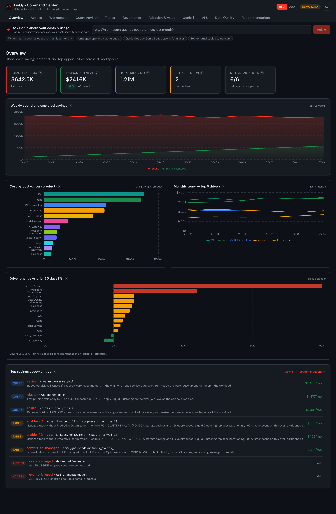

<div align="center">

**$642.5K/mo modelled spend** &nbsp;·&nbsp; **$241.6K/mo savings potential (37.6%)** &nbsp;·&nbsp; **12 workspaces, 64 queries, 30 tables, 91 grants, 12 monitored tables** &nbsp;·&nbsp; **24-play operator recommendation catalogue** &nbsp;·&nbsp; **up to 14 pages, 4 deploy-time feature flags, USD/AUD**.

</div>

> **New since first release:** a **Data Quality** tab (Lakehouse Monitoring inventory + cost tie-in), an **Ask Genie** streaming Q&A banner, **Genie cost attribution** (Genie Code vs Genie Spaces), **deploy-time feature flags** with **4 deploy variants**, **dual currency** (USD/AUD), and **cost-by-driver cost-by-driver / spike-detection** views. See the [Deployment guide](docs/CUSTOMER_DEPLOYMENT.md) for the flag matrix and grants.

---

## Contents

- [What is it?](#what-is-it)
- [Key capabilities — per page](#key-capabilities--per-page)
  - [Overview](#overview) · [Access](#access) · [Workspaces](#workspaces) · [Query Advisor](#query-advisor) · [Warehouse Monitor](#warehouse-monitor) · [Cluster Efficiency](#cluster-efficiency) · [Tables](#tables) · [Governance](#governance) · [AI $](#ai-) · [Adoption & Value](#adoption--value) · [Data Quality](#data-quality) · [Recommendations](#recommendations)
- [Ask Genie](#ask-genie)
- [Genie cost attribution](#genie-cost-attribution)
- [**How the numbers are calculated**](#how-the-numbers-are-calculated)
- [Feature flags & deploy variants](#feature-flags--deploy-variants)
- [Dual currency & cost-by-driver cost views](#dual-currency--alinta-style-cost-views)
- [Architecture](#architecture)
- [Tech stack](#tech-stack)
- [Data requirements](#data-requirements)
- [**Deploy it in a customer workspace**](#deploy-it-in-a-customer-workspace) → full step-by-step in the [Customer deployment guide](docs/CUSTOMER_DEPLOYMENT.md)
- [Local development](#local-development)
- [Customisation](#customisation)
- [Roadmap](#roadmap)
- [Known limitations](#known-limitations)

---

## What is it?

**Estate Command Center** is a full-stack Databricks App that gives a platform operator a single pane of glass over the cost, usage, access, and governance posture of an entire Databricks estate — and turns every finding into a **grounded, priority-ranked recommendation**.

It consolidates the family of cost/usage tools the field has built into one deployable app:

| Tool folded in | What it contributed |
|---|---|
| **Query observability** | The AI-insight query table — statement-level metrics + per-query cost-optimisation rationale (now the **Query Advisor** page). |
| **Workspace health check** | Workspace-by-workspace health / complexity / optimisation scoring with faceted filters (now the **Workspaces** page). |
| **GenAI cost governance** | AI-Gateway / FMAPI budget + rate-limit plays (folded into **Governance** + **Recommendations**). |
| **Cost-by-driver hub** | Cost-by-driver, SKU-level in-region breakdowns, MoM spike detection (folded into **Overview**, **Workspaces**, and a **Recommendations** trigger). |
| **Consumption dashboards** | The spend/DBU trend, per-SKU and per-product attribution rollups behind the **Overview** and **Workspaces** views. |

It ships with a seeded, **Acme-shaped demo dataset** (clearly labelled `DEMO DATA` in the UI) and the **real system-table SQL** wired behind a `USE_LIVE=false` flag, so the same app runs offline for a demo and against live system tables in production without a code change.

---

## Key capabilities — per page

Nav tabs (up to 14): **Overview · Access · Workspaces · Jobs · Query Advisor · Warehouses · Clusters · Tables · Governance · Adoption & Value · Genie $ · AI $ · Data Quality · Recommendations**. **Data Quality** is a *feature-flagged* tab — it only appears when `features.dqm=true`, so a deployment without it shows 13 tabs (see [Feature flags & deploy variants](#feature-flags--deploy-variants)).

A persistent [**Ask Genie**](#ask-genie) banner sits beneath the nav when `features.genie=true`.

### Overview

The estate dashboard. A KPI row — **Total spend/mo**, **Savings potential** (`$` + `% of spend`), **Total DBUs/mo**, **Top cost driver** (largest `billing_origin_product` by spend), **#Need attention** (critical health) — over a weekly **spend-and-captured-savings** trend chart, then the [cost-by-driver cost views](#dual-currency--alinta-style-cost-views): **cost by cost-driver (product)**, **monthly trend — top-5 drivers**, and a **driver-change-vs-prior-30-days (%)** bar for **MoM spike detection** (drivers up ≥ 25% MoM fire a cost-spike recommendation). A **Top savings opportunities** rollup ranks the highest-impact recs cross-page (worst queries, worst external tables, most over-privileged principals) and deep-links into the Recommendations hub. This is the *only* page besides Recommendations that carries advice, and only as a teaser. A **USD/AUD** toggle in the header restates every `$` figure.

### Access

**A factual, bidirectional grants explorer — no AI recommendations.** It answers *"what does each AD group / user / service principal have access to?"* and the exact reverse, off the same grant graph:

- **Data-centric ("who can access this securable?")** — cascade **workspace → catalog → schema → table** and see every grant: principal, privilege (`USE`/`SELECT`/`MODIFY`/`ALL PRIVILEGES`/…), **direct vs inherited**, plus any row filter, column mask or ABAC policy in effect.
- **Principal-centric ("what can this principal access?")** — pick a group / user / SP and see all their entitlements (workspace access, cluster-create, SQL-access) and every object grant they hold, resolved through **(nested) group membership** so *effective* access is correct.

Plus a **principal directory** (source AIM / SCIM / local, status, last-active), an expandable **group-membership tree**, a **PAT/token inventory** with age, and **risk flags** (over-privileged prod, direct-to-user grants, broad `account users`/`PUBLIC`, admin sprawl, stale grants, external-location write). Demo set: **20 principals · 91 grants · 26 risk flags**.

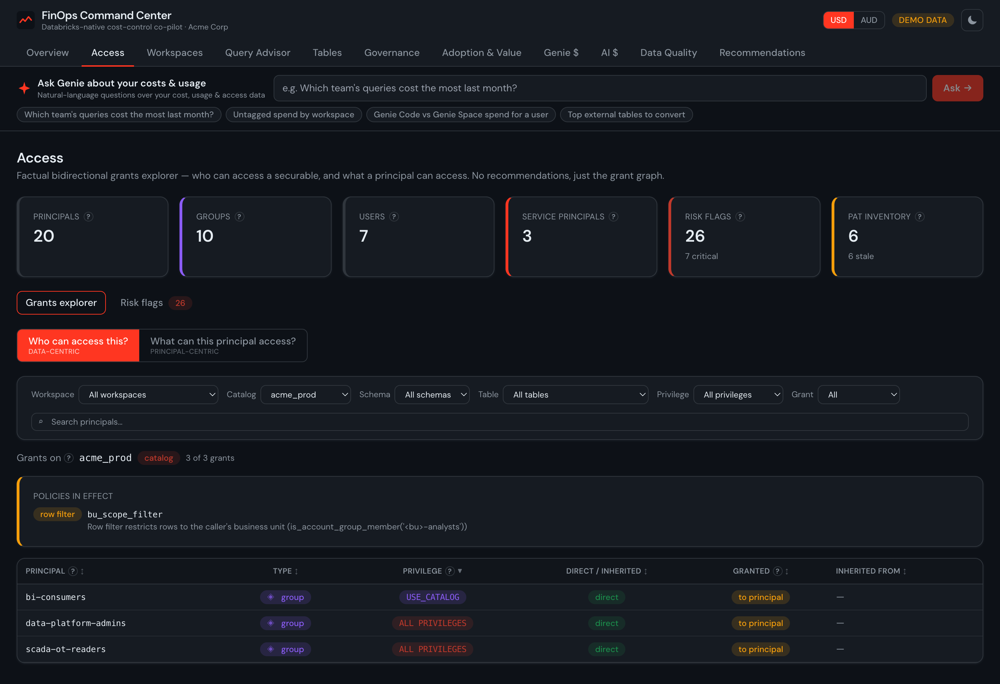

### Workspaces

Workspace-by-workspace analysis mirroring the workspace health check. A sortable, faceted table — **Workspace · Workspace ID · Spend/mo · Savings/mo · Savings % · Automated % · Health · Complexity · trend sparkline** — with facets on complexity, health, search, and customer/BU (the customer/BU facet appears only when a `workspace_bu_table` is configured).

- **Health rule:** Good ≥ 60% automated, Warning 25–60%, Critical < 25% (automated = scheduled-jobs compute vs interactive/all-purpose). The per-workspace **savings/mo** formula is in [**How the numbers are calculated**](#workspaces--savings--health).
- **Drill-down** per workspace: product/SKU mix (serverless · DLT-Lakeflow · jobs-classic · all-purpose · SQL warehouse · model serving · apps · FMAPI · PO) with % share; monthly trend; top users / jobs / warehouses by `$`; DBU total; idle %; serverless share; region; #clusters/#warehouses; and the **by-SKU** sub-view with `_AUSTRALIA_EAST` SKUs and `pct_of_total`.

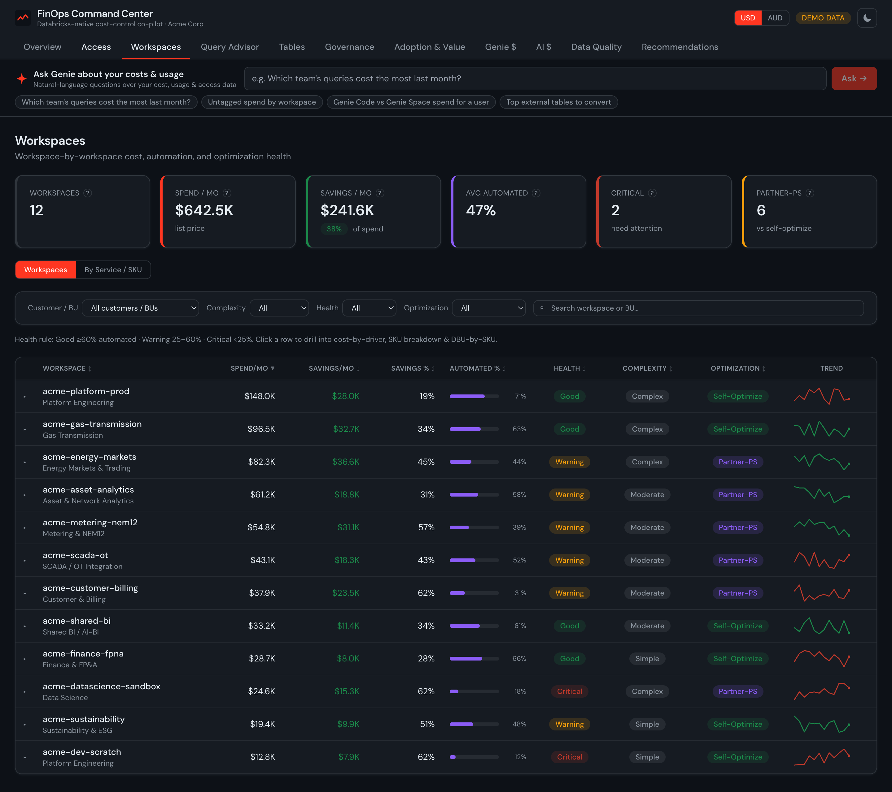

### Jobs

**A facts-only, per-job cost & reliability view — no serverless-migration advice.** It answers *"which jobs cost the most, which are failing, and which are getting slower or more expensive?"* straight from `system.lakeflow.jobs` + run timelines and `system.billing.usage`. Per job it surfaces: **cost/mo**, **failure rate** + **rising-failure** trend, **run-time spikes**, **cost growth** (month-over-month cost change), **setup + queue share** of run time, **failed-run `$/mo`** (an estimate — the compute burned by runs that failed), and **cost/run**.

- **Deliberately fact-only:** the Jobs tab does **not** flag serverless-migration candidates and does **not** estimate serverless savings. This is intentional — serverless jobs DBUs list at ~2× classic and net cost often *rises*, so a credible serverless saving needs an A/B run, not a static estimate. The page reports the facts an operator needs to decide, and leaves the migration call to them.

### Query Advisor

The query observability — query-level *observability* that feeds the Recommendations hub. KPI row (**Runs · Critical · Compute-h · Est. Cost · Biggest Spill · Applied**) over the AI-insight table:

- Columns: **# / Impact (score bar) / Query (truncated, expandable) / AI INSIGHT (pill: `cluster` | `resize` | `rewrite` | `vacuum` + one-line rationale) / SRC / Warehouse / User / Runs / p95 / Cost / Flags / Actions**. Expand a row for full SQL, full insight, estimated savings and next steps.
- Filters: time range (`1h`/`6h`/`24h`/`7d`/custom — scales runs & cost in the KPI row), warehouse ▾, workspace ▾, p95-threshold slider, flags ▾, search.
- Flags: `slow`, `high-spill`, `capacity-bound`, `full-scan`, `small-files`, `skew`, `cross-region`. Powered by the deterministic [recommender](#architecture) (§4 of the spec). Demo set: **64 queries**. → The exact flag thresholds, insight-classification order, savings formulas, impact score and confidence are in [**How the numbers are calculated**](#query-advisor--flags-savings--impact).
- **EXPLAIN-validated AI rewrite** *(on `rewrite`-type insights; needs `ai_narration`)* — the drill-down offers **"Suggest & validate rewrite"**: the in-region model (`FINOPS_LLM_ENDPOINT`) proposes a concrete rewritten `SELECT`, then the app runs `EXPLAIN` against your own warehouse and **only shows a rewrite that binds to your real schema** — a hallucinated column fails EXPLAIN and is *rejected*, never presented as runnable. A read-only guard runs before anything touches the warehouse, and EXPLAIN never executes the query. Honest by design: EXPLAIN proves it *runs and binds*, not that results are identical — review before running. (Demo mode shows a deterministic illustrative rewrite that projects the query's own predicate columns.)

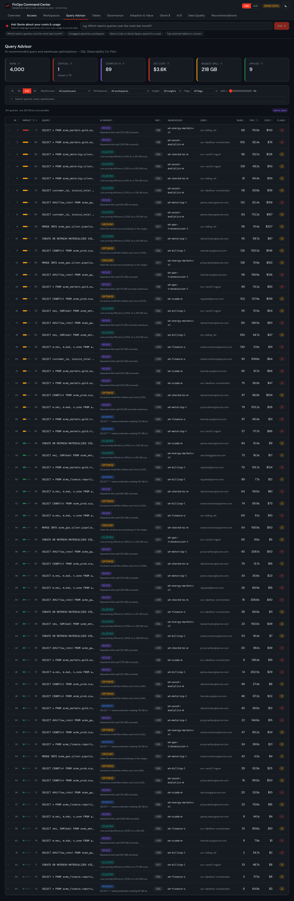

### Warehouse Monitor

Per-SQL-warehouse operational health (incl. serverless SQL) — *observable facts only, no model, always on*. KPI row (**Warehouses · Capacity-bound · Idle spend · Spilling · Total cost/mo**) over a warehouse list: type/size, runs, p50/p95, **queued %**, spill, users, cost/mo, and per-warehouse **watch-flags** (`capacity-bound` >15% queued · `slow` high p95 · `spilling` ≥25 GB · `idle` low-runs-real-$). Drill into a warehouse for its **hourly query-volume heatmap**, top users by runs, and a **query-source split** (SQL editor / notebook / job / dashboard / Power BI / Tableau / JDBC). Multi-select filters (workspace · type · watch) + time period. Live source: `system.query.history` aggregated per warehouse — **fail-soft** (an ungranted table shows a clear message, never a fabricated number). Demo set: **8 warehouses**.

### Cluster Efficiency

Interactive / all-purpose clusters — the right lens for *cluster* waste (sizing/idle, not SQL tuning). KPI row (**Clusters · Idle / no auto-stop · Oversized · Cost · Recoverable**) over a cluster list: workers (fixed vs autoscale), auto-stop, mean CPU, cost, **estimated recoverable $**, and per-cluster **findings** (`no-auto-stop` · `idle` · `oversized` · `no-autoscale` · `long-auto-stop` · `mem-pressure`). A **utilisation-window** selector (7 / 14 / 30 / 60 / 90 days) rescales CPU/idle, cost, DBUs and the recoverable estimate — every window-dependent value carries its window in the label (e.g. *Cost (90d)*), and the config-based `oversized` finding is called out as moving less with the window. Drill in for config, CPU/memory utilisation, CPU-by-hour and each finding's detail. The recoverable figure is deliberately **conservative — a single dominant lever per cluster, not additive** — and labelled *estimated*. Built on `system.compute.clusters` + `system.compute.node_timeline` + `system.billing.usage`; the time filter re-windows from a **daily-grain accumulator** (`finops_gold_cluster_daily`) so it can look back **further than `node_timeline` retention**. It **does not** analyse individual queries — cluster query telemetry isn't in system tables (the Spark UI is for per-query tuning); the UI says so. Demo set: **8 clusters**.

### Tables

Managed vs external tables + optimisation economics. Split KPIs (**#Managed vs #External · % managed · external-table `$` opportunity · storage reclaimable GB + `$` · #needing OPTIMIZE / VACUUM / clustering**) over a table list — `catalog.schema.table`, **type (MANAGED / EXTERNAL)**, `sizeInBytes`, `numFiles`, avg file size, small-file ratio, last OPTIMIZE / VACUUM, partitioned?, clustered?, PO enabled?, LC enabled?, scan `$/mo`, **est. savings**, **recommendation**.

- **External tables** get a flag + `$`-saved estimate (storage reclaim + scan reduction) and a **convert-to-managed** path (CTAS / DEEP CLONE) unlocking Predictive Optimization, Liquid Clustering and catalog-managed commits.
- **Managed tables without PO/LC** get an *enable Predictive Optimization + `CLUSTER BY AUTO`* rec, with the DLT `cluster_by_auto` known-issue caveat (needs DBR 15.4 LTS+ and PO enabled at the target catalog/schema *before* pipeline validation). All savings labelled *estimated* with assumptions shown. Demo set: **30 tables**. → Savings formulas (OPTIMIZE / VACUUM / convert-to-managed / enable-PO+LC) in [**How the numbers are calculated**](#tables--savings-components).

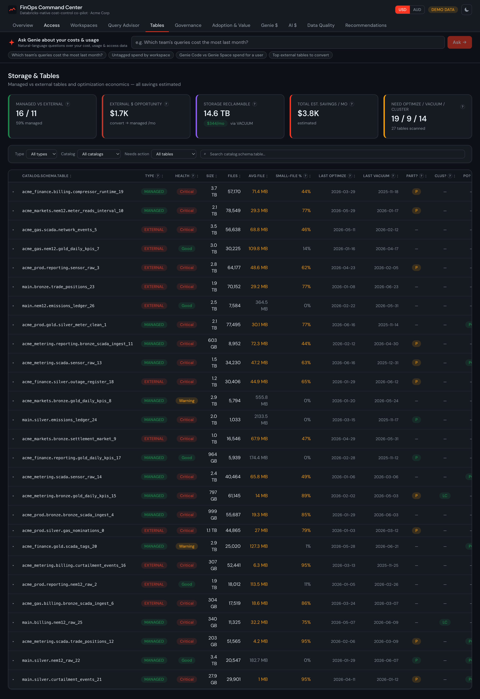

### Governance

Cost-governance posture as **scored tiles** (Good / Warning / Critical), each with the specific gap + next action: tagging coverage % + untagged spend `$`; budget-policy count + coverage; PO / LC adoption %; certification %; lineage coverage; external/unmanaged data % (ties to Tables); cluster-policy coverage; PAT/token risk; over-privileged-principal count (ties to Access); alert/budget setup; audit anomalies. Demo set: **13 tiles**.

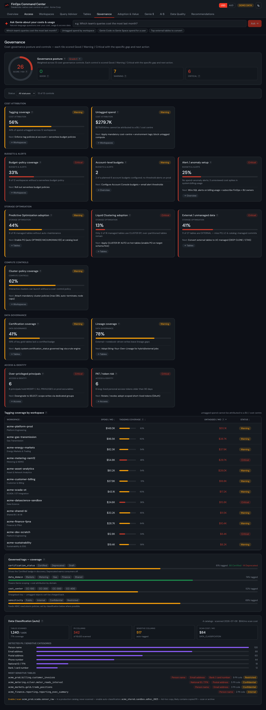

Governance also surfaces **Governed Tags + Data Classification**: governed-tag coverage (e.g. `system.certification_status`, domain, team) and auto **Data Classification** results (`class.*` column tags — PII/email/name/IP/age) read live from `system.information_schema.{table_tags,column_tags}`. The budget / budget-policy / cluster-policy / PAT / alert tiles come from admin APIs via the `estate-command-center-admin-sync` daily job into the Delta `<ingest_schema>.finops_admin` table; until it runs, live mode shows a "run finops_admin_sync" prompt for exactly those tiles (never sample), and a **Last refreshed** time once ingested.

### AI $

**All AI/GenAI spend a team would investigate, on one page** — Model Serving, Foundation Model APIs, Vector Search, Agent Bricks, AI Functions, and fine-tuning — by product, endpoint, owner, workspace, and trend, from `system.billing.usage`. Carries **cost-optimisation flags** (e.g. endpoints that could scale-to-zero) and a **"% of total platform spend"** context line so AI spend is seen in proportion (it's usually a small slice) rather than in isolation. Genie is on its own **Genie $** page; this page covers the rest of the AI family. Always on (calls no model).

### Adoption & Value

**Who actually uses the estate, and which data earns its keep.** A **value map** (usage × recency, bubble-sized by distinct users) places every heavily-used, fresh asset in a "gold" quadrant and every stale/unused one in an "archive/prune" quadrant — from `system.query.history` + `system.access.table_lineage`. Turns "we have 40k tables" into "these 200 carry the value; these 3k are candidates to archive."

### Data Quality

**Feature-flagged (`features.dqm`) — a Lakehouse-Monitoring inventory with a FinOps cost tie-in.** Because this is a cost tool, the page answers *"which monitors am I paying for, and are they earning their keep?"* not just *"are my tables healthy?"*. Split KPI row — **#Monitors** (Lakehouse Monitoring) · **Critical/Warning** (drift or nulls) · **Stale refreshes** (past cadence) · **Alerts firing** · **DQM cost/mo** (the `DATA_QUALITY_MONITORING` billing line) · **Prune savings/mo** — over a monitored-tables list:

- Columns: **Monitored table** (`catalog.schema.table` + workspace) / **Type** (Snapshot / TimeSeries / Inference) / **Quality** (Good / Warning / Critical) / **Drift (PSI/KS)** / **Null %** / **Anomalies** / **#Metrics** / **Freshness** (Fresh / OK / Stale + *hours ago* vs its refresh cadence) / **Alerts** (set / firing) / **Cost/mo** — with a **`prune?`** hint on low-value monitors.
- **FinOps tie-in:** a **`DATA_QUALITY_MONITORING` cost-by-workspace** breakdown (from `system.billing.usage`) shows which monitored tables/workspaces drive the monitoring spend, and a **"prune monitors on low-value tables"** panel lists monitors that are stale or quiet (no anomalies/alerts) — monitoring that surfaces nothing actionable — with the `$/mo` reclaimed by pausing them. Refresh DBUs run on serverless; figures are list-price reference, Account Console is the source of truth.
- **Data source:** [Lakehouse Monitoring](https://learn.microsoft.com/azure/databricks/lakehouse-monitoring/) — live mode detects existing monitors via monitor metadata / `information_schema`; demo mode ships 12 representative monitors. When `features.dqm=false` the tab **and** `/api/dqm` are absent (inert server-side, not just hidden). Demo set: **12 monitored tables**.

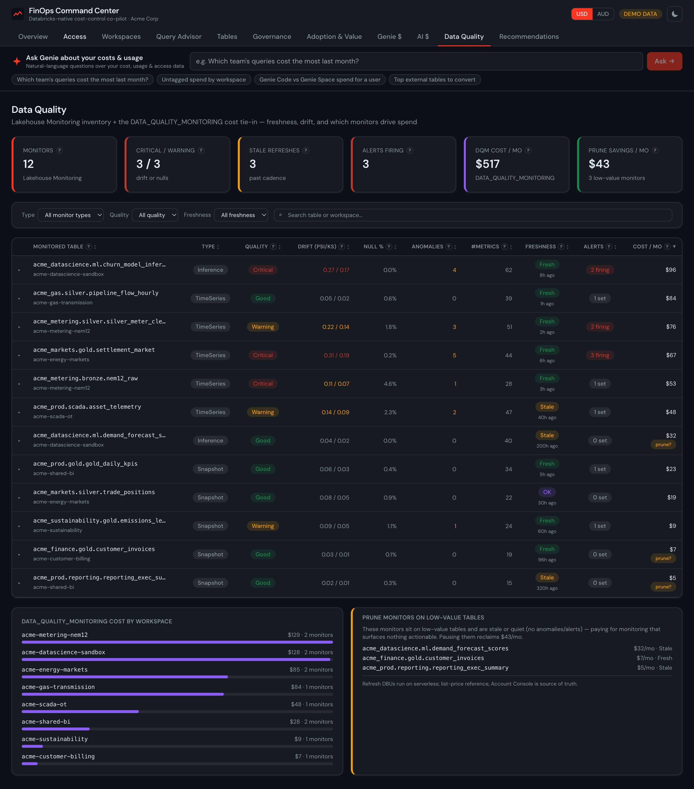

### Recommendations

**★ The primary advisor surface — the unified operator advisor hub.** It aggregates recs from Query Advisor, Tables, Governance and Access-cost, then layers **platform-operator strategic plays** from a **24-play catalogue** (`reference/recommendation_catalog.yaml`) across six categories — *behavioural/enablement · compute · storage · tagging & cost attribution · AI/GenAI spend · access/governance*.

- **Two views:** **Overall** (all recs ranked by priority/savings across the estate) and **Per-workspace** (filtered to one workspace). Filters: **workspace ▾ · priority (P1/P2/P3) · category · scope**.
- **Each rec:** priority pill, category pill, operator-facing title, scope (global/workspace/BU/team/user), **est `$`/mo savings**, effort (Low/Med/High), **evidence chips** (the metrics that fired it — e.g. *"412 queries · 3 users · $4.2K"*), **"What to do"** concrete steps, recommended-feature pills each naming the feature, and a suggested owner. Expandable.
- **Priority model:** `P1 = high $ impact × low effort × (or high risk)`; score = `normalise($/mo × frequency/severity ÷ effort) × risk_multiplier`. Sorted by tier then `$`. → Full scoring + tier-assignment rules in [**How the numbers are calculated**](#recommendations--priority).
- **Cost-attribution panel:** spend by workspace / BU / tag / user, untagged %, top cost drivers, the specific tagging + budget-policy plays to close attribution gaps, **and a [Genie-spend breakdown](#genie-cost-attribution)** (Genie Code vs Genie Spaces per workspace × user).

> **Working with alerts (acknowledge / ignore).** Every alert surface (Recommendations, Jobs, Warehouses, Clusters, Tables, Query Advisor) carries a single **always-visible action bar** above the table: a **status filter** (Open · Acknowledged · In progress · Won't fix · All, with counts) and an **Acknowledge** action that's disabled-with-a-hint until you tick one or more rows (so it's discoverable before selecting). Tick rows → acknowledge them in one step (with an optional reason + snooze), or **reopen** acked ones. Acknowledged items drop out of the default *Open* view and **auto-reopen** if the underlying metric gets materially worse (>25%) or the snooze lapses — so dismissing an alert is never permanent forgetting. Requires the `writeback` flag (on by default). See [Feature flags](#feature-flags--deploy-variants) for the live-mode persistence requirement.

> **Business-unit filters.** When you supply a `workspace_bu_table` mapping, a **Business unit** filter appears on Jobs, Warehouses, Clusters, Query Advisor, Workspaces and Recommendations (a job/warehouse/etc. inherits its workspace's BU). When no mapping is configured the BU dimension is hidden everywhere — nothing shows a blank placeholder.

> **Built for a real estate's scale.** The heavy live tabs are served through a **two-tier cache** (in-process + an optional persistent Lakebase tier) with stale-while-revalidate, so repeat loads are ~1–2s and the cache **survives restarts/redeploys** rather than re-paying a cold scan. Wide tables **hide lower-priority columns responsively** (they move into the row drill-down) so you don't scroll sideways on a laptop, and big lists (e.g. tens of thousands of jobs) show the **most-worth-investigating top-N by default** with a **"Load all"** opt-in — KPI totals are always computed over the full set.

| Overall, ranked | Filtered to P1 |
|---|---|
| 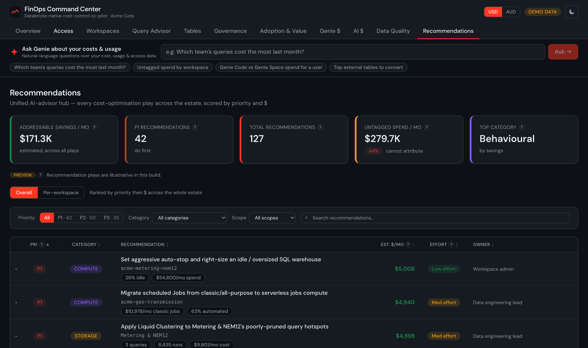 | 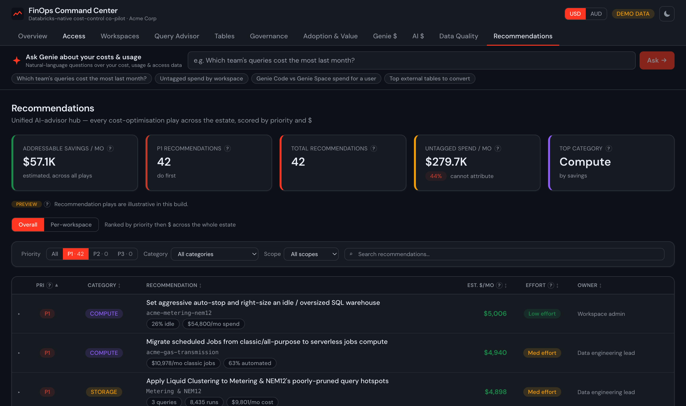 |
| **Expanded rec — evidence + steps + feature pills** | **Per-workspace view** |
| 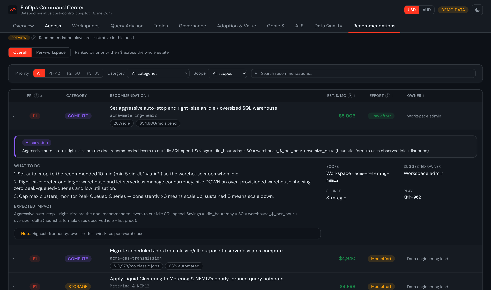 | 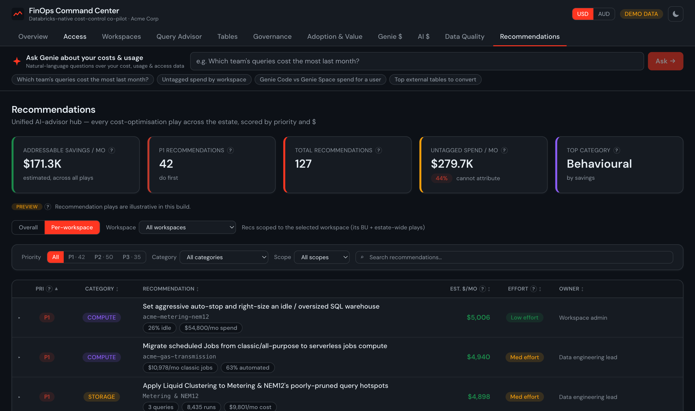 |
| **Cost-attribution + Genie spend** | |
| 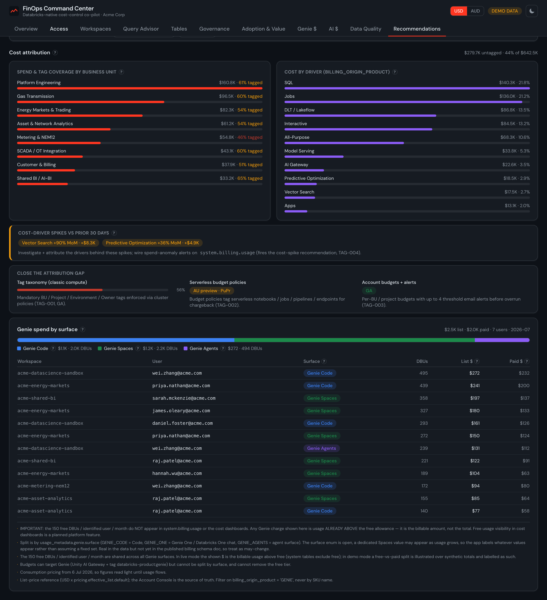 | |

---

## Ask Genie

**A streaming natural-language front door to the estate — gated by `features.genie`.** A persistent banner sits beneath the nav: *"Ask Genie about your costs & usage"* — a text input plus suggested-prompt chips (*"Which team's queries cost the most last month?"*, *"Untagged spend by workspace"*, *"Genie Code vs Genie Space spend for a user"*, *"Top external tables to convert"*). Answers **stream in over SSE** (like GridSense's `useGenieStream`) via the **Genie Conversation API** against a **Genie Space**, and a **follow-up** chip row keeps the conversation going.

**The Genie Space is comprehensive + auto-provisioned — no manual setup.** It's curated over **9 system tables** so questions can range across cost, SQL, jobs, warehouses, clusters, lineage and workspace context — not just billing:

`system.billing.usage` · `system.billing.list_prices` · `system.query.history` · `system.access.table_lineage` · `system.access.workspaces_latest` (so answers use workspace **names**, not ids) · `system.compute.warehouses` · `system.compute.clusters` · `system.compute.node_timeline` · `system.lakeflow.job_run_timeline`

- **Auto-provisioned + auto-discovered:** on deploy the app **creates** a `Estate Command Center` Genie Space over those tables if one doesn't exist, and **discovers it by title** on startup — so you do **not** need to set `genie_space_id` (set it only to point at your own Space instead). Re-provisioning **reuses and syncs** the existing Space (dedupe by title prefix), so restarts never spawn duplicates. *(Deliberately excluded from the Space: `information_schema.*` — per-catalog + noisy for NL — `access.audit` — huge — and the optional/grant-gated `data_quality_monitoring` / `data_classification` tables, which would error the Space if ungranted.)*
- **Live mode = real Genie only, never a demo answer.** In live the app calls the real Genie Conversation API. If a Space isn't configured/available it says so honestly ("Ask Genie isn't configured…"); if Genie can't answer it says so — it **never** fabricates a canned answer. The `demo answer` (with its synthetic chart) appears **only in demo mode**.
- **Demo mode:** returns **canned, streamed** answers grounded in the seeded data, badged `demo answer`.
- **Inert when off:** with `features.genie=false` the banner is hidden **and** `/api/genie/ask` returns 404 — no Genie or model calls happen server-side.

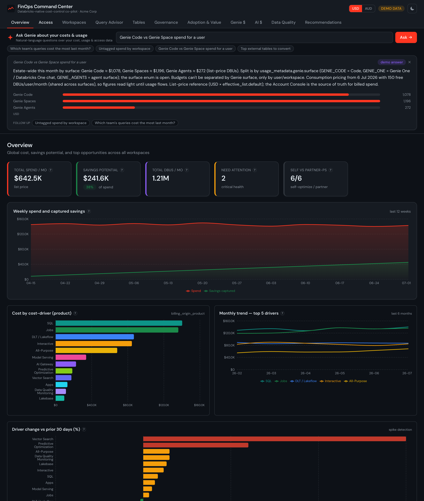

---

## Genie cost attribution

**Always on** (it calls no model, so it is not an "AI feature") and it has its own **Genie $** tab plus panels in [Recommendations](#recommendations) and the [Workspaces drill-down](#workspaces). Genie is billed under `billing_origin_product = 'GENIE'` with a `usage_metadata.genie` struct `{surface, channel, agent_id}`. The app splits Genie spend **by surface, per workspace × user** — verified against real `system.billing.usage`:

| `usage_metadata.genie.surface` | Shown as | What it is |
|---|---|---|
| `GENIE_CODE` | **Genie Code** | NL-to-SQL in the SQL editor / notebook (technical users) |
| `GENIE_ONE` | **Genie Spaces** | Genie One / Databricks One conversational chat (business users) |
| `GENIE_AGENTS` | **Genie Agents** | Genie called programmatically inside an agent (Agent Bricks / API) |

The surface enum is **open** — the app labels whatever values appear rather than assuming a fixed set. Three queries (in [`data/queries.sql`](data/queries.sql), assembled once in `data/genie_cost.py` so demo and live reconcile) back it: (1) ground-truth usage by `usage_date × workspace × run_as × surface`; (2) an approximate **paid** split, pro-rating each user's paid DBUs across surfaces *after* the shared **150-free-DBU-per-identified-user-per-month** allowance; (3) per-workspace totals. **This is the first panel wired for [live mode](#what-reads-live-vs-how).**

**Caveats shown in the UI (not glossed over):**

- The surface split is **real in the billing data but not yet in the published schema doc** — treat as may-change; the app degrades to per-user/workspace totals if the field is null.
- The 150 free DBUs are **shared across all surfaces**, so per-surface *paid* `$` is a pro-rated estimate; only the per-user total paid figure is exact.
- **Budgets can target Genie** (Unity AI Gateway + tag `databricks-product: genie`) but **cannot be split by surface**, and cannot remove the free tier.
- `$` is **list-price reference** (`usage_quantity × pricing.effective_list.default`); the **Account Console is the source of truth**. Filter on `billing_origin_product = 'GENIE'`, never by SKU.
- Consumption-based pricing began **6 Jul 2026**, so figures **read light until usage flows**.

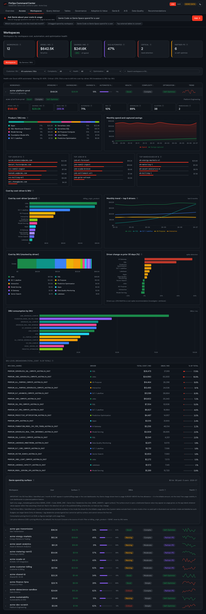

---

## How the numbers are calculated

Every `$` figure in the app is a **deterministic, rule-based estimate** — no model is involved in any calculation. (The optional LLM only rewrites the *wording* of a recommendation's rationale, never its number; see [Feature flags](#feature-flags--deploy-variants).) Each estimate follows one shape: **observed cost × a published reduction fraction × how severe the measured inefficiency is**, so it is fully explainable and auditable. Those reduction fractions are expert-set constants named at the top of [`data/recommender.py`](data/recommender.py) and [`data/generate_demo.py`](data/generate_demo.py) — change them there and every downstream figure moves with them. The inputs are the customer's real `system.*` metrics in live mode or the seeded Acme metrics in demo mode; the formulas are identical either way. All `$` are **list-price reference** (`usage_quantity × pricing.effective_list.default`), labelled *estimated* in the UI — the Account Console is the source of truth.

### Query Advisor — flags, savings & impact

Each query row is scored purely from its statement metrics (`system.query.history`), in three steps: **flag → classify → estimate**.

**1. Diagnostic flags** — each maps to one measurable condition:

| Flag | Fires when |
|---|---|
| `slow` | p95 latency ≥ 30 s |
| `high-spill` | disk spill ≥ 20 GB |
| `capacity-bound` | queued ratio ≥ 20% |
| `full-scan` | pruning < 30% **and** ≥ 50 GB read (or `SELECT *` on a ≥ 50 GB read) |
| `small-files` | small-file ratio ≥ 40% |
| `skew` | partition skew ratio ≥ 3× |
| `cross-region` | query reads across a region boundary |

**2. Classification** — the single highest-leverage lever wins, in this order: **resize** (spill ≥ 20 GB) → **cluster** (pruning < 30% on a ≥ 50 GB scan) → **rewrite** (`SELECT *` / weak predicates under 45% pruning) → **optimize / vacuum** (small files / stale versions).

**3. Estimated `$/mo` savings** = the statement's observed monthly cost × the lever's expected reduction × the strength of the signal:

| Lever | Formula |
|---|---|
| `cluster` | `cost × 0.55 × (1 − pruning)` |
| `resize` | `cost × 0.60 × min(1, spill_gb ÷ 220)` |
| `rewrite` | `cost × 0.40 × min(1, (1 − pruning) + 0.3)` |
| `optimize` | `cost × 0.35 × max(0.4, small_file_ratio)` |
| `vacuum` | `cost × 0.255` (stale-version re-read overhead) |

The **impact score (0–100)** that ranks the table is `savings + frequency + severity`, each capped and weighted:
`min(1, savings ÷ $3,500)×40 + min(1, runs ÷ 3,000)×30 + severity×30`, where `severity = (1 − pruning)×0.5 + min(1, spill ÷ 220)×0.3 + min(1, p95 ÷ 260)×0.2`.
**Confidence** rises with signal strength and run count: `0.55 + 0.30×severity + 0.10×min(1, runs ÷ 1,000)` (rewrites −0.05), clamped to 0.50–0.97.

### Tables — savings components

In live mode `table_type` comes from `information_schema` (authoritative — external tables classify correctly) and **bulk sizes** come from the nightly gold census (`finops_gold_table_sizes`); **file-hygiene** stats (`numFiles`, small-file ratio via `DESCRIBE DETAIL`) are **deferred to drill-down**. A **cold-storage** view flags large-but-rarely-read tables. Storage is priced at `$0.023/GB/mo` (list). The savings components (`$/mo`):

- **OPTIMIZE** (compaction) = `scan_cost × small_file_ratio × 0.60`
- **VACUUM** (reclaim) = `reclaimable_GB × $0.023`, where `reclaimable_GB = size_GB × stale_ratio`
- **Convert external → managed** = `OPTIMIZE + VACUUM + scan_cost × 0.35` (the auto-Liquid-Clustering scan uplift unlocked by going managed)
- **Enable PO + Liquid Clustering** (managed without PO) = `size_GB × $0.023 × 0.50` (PO ≈ 50% storage cut) `+ scan_cost × 0.95` on an over-partitioned table, else `× 0.35`

The headline **est. savings** for a table is the figure for its *recommended* action only, so components are never double-counted.

### Workspaces — savings & health

Per-workspace **savings/mo** = `spend × (0.10 + 0.55×automation_gap + 0.40×idle% + 0.25×(1 − serverless_share))`, capped at **62% of spend**, where `automation_gap = max(0, 0.75 − automated%)` and *automated* = scheduled-job compute ÷ all compute. **Health** is graded on automation alone: **Good ≥ 60%**, **Warning 25–60%**, **Critical < 25%**.

### Recommendations — priority

The hub aggregates every page's recs, then scores each one:

```
priority_score = normalise($/mo × severity) ÷ effort_weight × risk_multiplier
```

`effort_weight` is Low 1.0 / Med 2.0 / High 3.0, and `$/mo` is normalised against the highest-value rec in the set. A pure risk-avoidance rec (`$0` savings but high risk) still scores via `0.15 × severity × risk_multiplier`. **Tiering:** a rec is **P1** when it is both high-`$` (≥ 50% of the top rec) *and* low/medium effort, **or** it carries a high risk multiplier (≥ 1.3); **P2** when it is ≥ 20% of the top rec or medium effort; otherwise **P3** (the catalogue can also pin an explicit tier for specific plays). The list sorts by tier, then `$` descending.

### Genie spend & currency

The Genie **paid** split pro-rates each user's billable DBUs across surfaces *after* the shared 150-free-DBU-per-user allowance — see [Genie cost attribution](#genie-cost-attribution) for the full caveats (only the per-user total is exact; the per-surface paid `$` is an estimate). The **AUD** toggle restates every figure as `USD list price × fx_rate` (`app.yaml`, default `1.52`), labelled indicative.

---

## Feature flags & deploy variants

The app reads a single config source — the environment variables in **`app.yaml`** (or the App UI → Settings → Environment) — and surfaces it via **`/api/config`**. The frontend fetches `/api/config` once and **conditionally renders**: the [Ask Genie](#ask-genie) banner only if `genie`, the [Data Quality](#data-quality) tab only if `dqm`, and LLM rec narration only if `ai_narration`. Anything hidden is also **inert server-side** — its endpoints and any Genie/model calls are absent, not merely unrendered.

| Flag | Built-in default | Shipped `app.yaml` | Gates | Notes |
|---|---|---|---|---|
| `features.genie` | `true` | `true` | Ask Genie banner + `/api/genie/ask` SSE | Genie Conversation API over the auto-provisioned/`genie_space_id` Space. |
| `features.ai_narration` | **`false`** | `true` | AI SQL-rewrite panel (+ optional LLM rec rationale) | **Off by default** (no model calls / no surprise spend) — the shipped demo config turns it on to showcase the EXPLAIN-validated rewrite. Falls back to deterministic text if no endpoint. |
| `features.dqm` | `true` | `true` | Data Quality tab + `/api/dqm` | Lakehouse Monitoring inventory + cost tie-in. |
| `features.writeback` | `true` | `true` | Acknowledge/ignore controls on every alert surface + `/api/acks` | **On by default** — independent of AI/Genie. State lives in a managed Lakebase (Postgres) instance on the recommended `-t customer` deploy; the `-t customer-delta` fallback uses a small Delta table via the read warehouse instead. Off ⇒ controls hidden + `/api/acks` 404. |

> The **deterministic recommender**, **cost-attribution**, and **[Genie cost attribution](#genie-cost-attribution)** are **always on** regardless of these flags — they call no model, so they are not "AI features".

**Composable deploy variants** — the capabilities toggle independently, so any subset can be on. This repo's `app.yaml` ships the three AI/observability flags on (to showcase everything); the safe built-in default is genie + dqm on, ai_narration off. `writeback` is a separate, AI-independent flag and is on by default in every variant. A few common combinations:

| Variant | `genie` | `ai_narration` | `dqm` | Tabs | For |
|---|:--:|:--:|:--:|:--:|---|
| **Default (everything on)** | ✅ | ✅ | ✅ | 14 | Full experience. |
| **AI only** | ✅ | ✅ | ❌ | 13 | AI appetite, no Lakehouse Monitoring. |
| **DQM only** | ❌ | ❌ | ✅ | 14 | DQM inventory, no Genie/LLM. |
| **Deterministic core only** | ❌ | ❌ | ❌ | 13 | Most conservative — no Genie, no LLM, no DQM. |

**Only `dqm` changes the tab count** — it gates the Data Quality tab. `genie` gates the Ask Genie banner (not a tab) and `ai_narration` gates only the LLM rec narration (no tab), so both leave the count unchanged.

Each capability is a single env var in `app.yaml` — set `FINOPS_FEATURE_GENIE`, `FINOPS_FEATURE_AI_NARRATION`, or `FINOPS_FEATURE_DQM` to `"false"` to ship that surface off, in any combination, with no code edits. See the **[Deployment guide](docs/CUSTOMER_DEPLOYMENT.md)** for the full flag matrix, the exact grants per variant, and the one-command bundle deploy.

The screenshot below is the **"neither" variant** — 13 tabs (no Data Quality), no Ask Genie banner — contrast it with the [Data Quality shot](#data-quality) above (the "AI + DQM" variant, showing DQM, Ask Genie, Genie spend and the USD/AUD toggle in one frame):

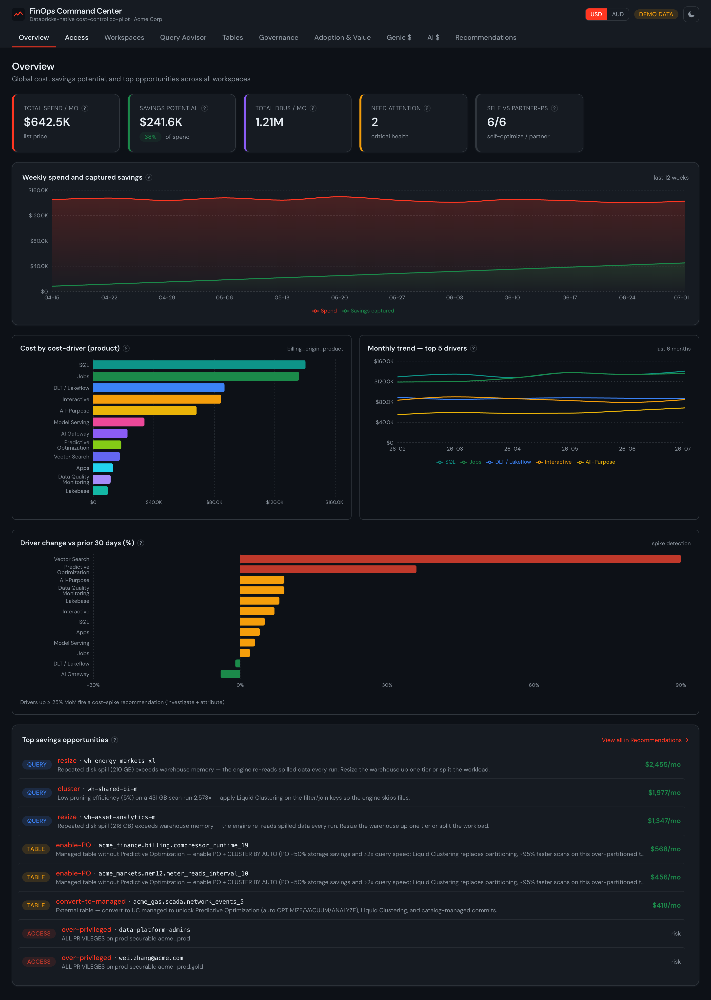

---

## Dual currency & cost-by-driver cost views

Folded in from the **cost-by-driver reference dashboard** — they validate the AU-East SKU framing (SKUs literally end in `_AUSTRALIA_EAST`):

- **Dual currency (USD/AUD).** A header toggle restates every `$` figure across the estate: AUD = list-price USD × `fx_rate` (`app.yaml`, default `1.52`), clearly labelled indicative. USD is the default.
- **Cost by cost-driver (product).** A bar of total cost per `billing_origin_product` (SQL, Jobs, Interactive, DLT/Lakeflow, All-Purpose, Model Serving, AI Gateway, Predictive Optimization, Vector Search, Apps, Lakebase, Data Quality Monitoring). → Overview + Workspaces drill-down.
- **Monthly trend — top-5 drivers.** A multi-line trend of the five biggest drivers over the last 6 months. → Overview + Workspaces.
- **MoM spike detection.** A **driver-change-vs-prior-30-days (%)** bar; drivers up **≥ 25% MoM** fire a **cost-spike recommendation** (*investigate + attribute*) in the [Recommendations](#recommendations) hub. → Overview + Workspaces + recommendation catalogue trigger.
- **SKU-level breakdown.** The Workspaces **By Service/SKU** sub-view lists every `_AUSTRALIA_EAST` SKU with `total_cost`, `DBUs/mo` and **`pct_of_total`** (e.g. `PREMIUM_SERVERLESS_SQL_COMPUTE_AUSTRALIA_EAST` 15.5%), plus cost-by-SKU (stacked by driver) and DBU-consumption-by-SKU charts.


---

## Architecture

Data sources → system tables → FastAPI (`app.py` + `data/*`) → React pages. Full narrative and per-layer design rationale in [`docs/ARCHITECTURE.md`](docs/ARCHITECTURE.md).

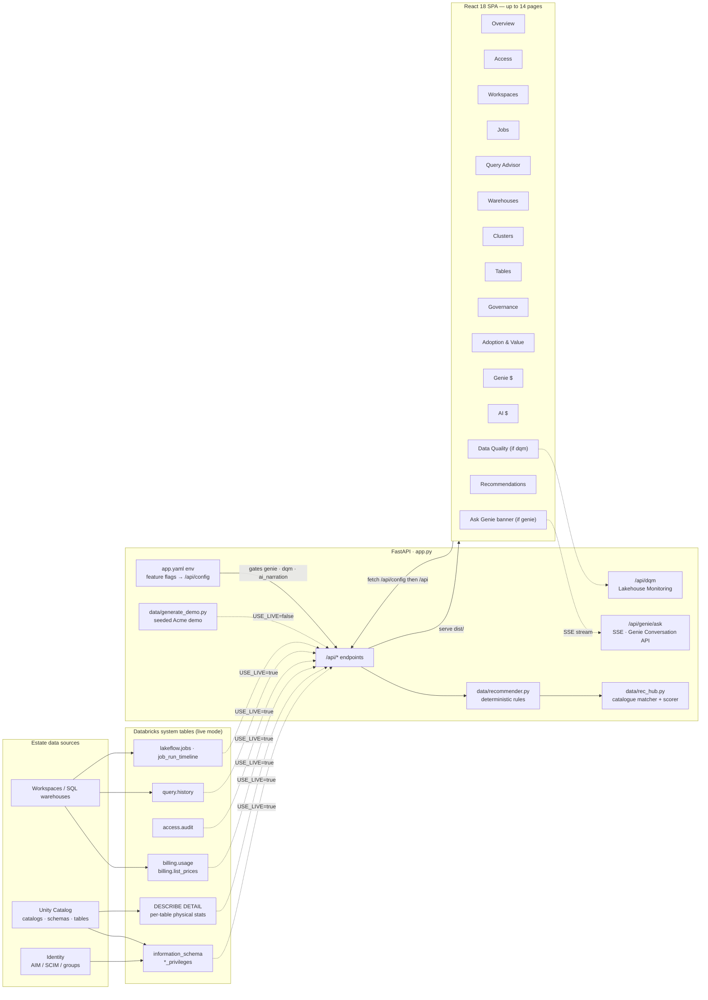

**Recommendation-engine flow** — how estate metrics become scored recs:

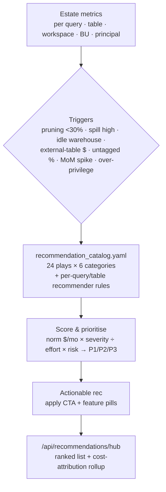

---

## Tech stack

- **Frontend:** React 18 · Vite · TypeScript · Tailwind (`darkMode: "class"`, CSS-var theming) · Zustand (state) · Recharts (charts) · react-markdown · DM Sans. GitHub-dark surface with a Databricks-red accent.
- **Backend:** FastAPI (`app.py`) serving `/api/*` and mounting the built SPA from `frontend/dist` via `StaticFiles`. Deterministic recommender (`data/recommender.py`) + catalogue-driven hub (`data/rec_hub.py`). An `app.yaml` env feature-flag layer surfaced via `/api/config`; SSE streaming for [Ask Genie](#ask-genie) (`/api/genie/ask`); a Lakehouse-Monitoring [Data Quality](#data-quality) endpoint (`/api/dqm`, flag-gated).
- **Deploy:** Databricks App — deployed as an **Asset Bundle** (`databricks.yml`) with `databricks bundle deploy -t customer` — **no Python, no npm** (the built `frontend/dist` is committed). `app.yaml` (the single run-config file) · `requirements.txt`.
- **Data:** `data/generate_demo.py` (seeded Acme-shaped demo, default) or live system tables via the Databricks SDK Statement Execution API (`USE_LIVE=true`, in `data/live.py`), with the exact SQL in `data/queries.sql`. Live mode serves from nightly precomputed **gold Delta tables** (`data/gold.py` → `<gold_schema>.finops_gold`).

---

## Data requirements

Demo mode (`USE_LIVE=false`, the default) needs **nothing** — no warehouse, no grants. Live mode (`USE_LIVE=true` + a SQL warehouse) runs the queries in [`data/queries.sql`](data/queries.sql). The app service principal needs **`SELECT`** on:

| System table / source | Powers | Notes |
|---|---|---|
| `system.billing.usage` | Overview, Workspaces spend/DBUs | GA |
| `system.billing.list_prices` | `$` figures (join to usage) | GA |
| `system.query.history` | Query Advisor, Warehouse Monitor, top users/warehouses | **PuPr** — badge in UI |
| `system.compute.clusters`, `system.compute.node_timeline` | [Cluster Efficiency](#key-capabilities--per-page) — interactive-cluster sizing / idle / CPU–memory | GA (`clusters` is SCD — latest row per cluster) |
| `system.access.audit` | Access last-access / stale grants | **PuPr** — badge in UI |
| `system.access.table_lineage` | Tables usage/health, Adoption value map | GA |
| `system.information_schema.*_privileges` | Access grant graph (table/schema/catalog/routine) | GA |
| `system.information_schema.{tables,table_tags,column_tags}` | External share, governed tags, `class.*` auto-classification | GA |
| `system.data_quality_monitoring.table_results` | Data Quality tab only (inventory + status). Deliberately NOT folded into Tables health — DQM has its own tab. | Only if `features.dqm` (degrades gracefully if ungranted) |
| `system.lakeflow.jobs`, `job_run_timeline`, `job_task_run_timeline` | Automated %, top jobs | GA (`*.pipelines` is PuPr) |
| `DESCRIBE DETAIL <fqn>` | Tables — `numFiles`, `sizeInBytes`, clustering/partition cols | Per-table; not a single system query |
| `system.billing.usage` (`billing_origin_product = 'GENIE'`, `usage_metadata.genie.surface`) | [Genie $](#genie-cost-attribution) — Code / Spaces / Agents per workspace × user | GA; always on; **live-wired** |
| `system.billing.usage` (`billing_origin_product = 'DATA_QUALITY_MONITORING'`) + monitor metadata / `information_schema` | [Data Quality](#data-quality) — monitor inventory + DQM cost | Only if `features.dqm` |
| **Genie Space** (`genie_space_id`) via the Genie Conversation API | [Ask Genie](#ask-genie) streaming Q&A | Only if `features.genie` |

The **Access** grant graph (principals · grants · risks) and drill-downs read live from `system.information_schema.*_privileges`. Group membership, workspace assignments, entitlements and PAT inventory come from the account **SCIM / Groups** + **workspace-assignments** + **token-management** REST APIs — not SQL — so they're pulled by the daily **`finops_admin_sync`** job into the Delta **`<ingest_schema>.finops_admin` table** and the app reads them from there (with a "Last refreshed" time). See `docs/ARCHITECTURE.md`.

The last three rows are **only** needed for the corresponding feature flag: DQM reads need the monitor metadata + the `DATA_QUALITY_MONITORING` billing line; Ask Genie needs the app SP to be able to **create / list Genie Spaces** (for auto-provision + title discovery) and `CAN RUN` on the Space, plus `SELECT` on the 9 curated system tables the Space queries (a subset of what the app already reads). All reads are read-only. The [Deployment guide](docs/CUSTOMER_DEPLOYMENT.md) lists the exact grants per deploy variant.

**Grant statement (minimum):**

```sql
GRANT SELECT ON SCHEMA system.billing            TO `<app-service-principal>`;
GRANT SELECT ON TABLE  system.query.history      TO `<app-service-principal>`;
GRANT SELECT ON SCHEMA system.compute            TO `<app-service-principal>`;  -- Cluster Efficiency (clusters + node_timeline)
GRANT SELECT ON TABLE  system.access.audit       TO `<app-service-principal>`;
GRANT SELECT ON SCHEMA system.information_schema  TO `<app-service-principal>`;
GRANT SELECT ON SCHEMA system.lakeflow           TO `<app-service-principal>`;
-- plus USE CATALOG / USE SCHEMA on any user catalog you want DESCRIBE DETAIL to reach.
```

Every API payload carries `demo` / `mode` metadata; the UI renders a **DEMO DATA** badge whenever `USE_LIVE=false`, so demo numbers are never mistaken for live ones.

---

## Deploy it in a customer workspace

Deployment lives in **one place** so there's nothing to reconcile:

> 📘 **[Customer deployment guide →](docs/CUSTOMER_DEPLOYMENT.md)** — the complete,
> step-by-step walkthrough: add the code, set your two values in `app.yaml`, deploy the
> Asset Bundle, grant read access, and turn on the nightly job. Includes the exact grants,
> the Lakebase-vs-Delta target choice, business-unit/team setup, upgrades and troubleshooting.

A few facts worth knowing before you open the guide (the guide has the how-to; this is the *why*):

- **One artifact, config-switched.** The same app ships to a demo workspace and to a customer's
  production workspace — a single config surface (`app.yaml`) decides what it reads. No code changes per customer.
- **Ships in live mode.** It reads the customer's real `system.*` tables as soon as a warehouse +
  gold schema are set; until then it boots on demo data with a "finish setup to go live" banner (never a hard fail).
- **Read-only by construction.** Only `SELECT` / `DESCRIBE` / read APIs run, as the app's own
  service principal (SDK credential chain — no PATs, no user tokens). A permission gap is an honest error, never fabricated data.
- **Gold serving layer (required for live at scale).** The app's reads are over account-wide system tables
  (tens of millions of rows), so the nightly `finops_gold_sync` job pre-aggregates them into a `gold_schema` the app reads in ~1s.
- **Writeback backend = the deploy target.** `-t customer` (recommended) uses a bundle-created Lakebase (Postgres) instance;
  `-t customer-delta` is the no-Lakebase fallback (a tiny Delta table). Acknowledge/ignore state, not required for read-only use.

---

## Local development

```bash
# 1. Backend — API serves demo data by default. Reuse the checked-in venv if present.
[ -d .venv ] || python3 -m venv .venv
source .venv/bin/activate
pip install -r requirements.txt        # registries are proxied — see Known limitations
uvicorn app:app --reload --port 8000

# 2. Frontend (another shell) — Vite proxies /api → :8000. Reuse node_modules if present.
cd frontend
[ -d node_modules ] || npm install
npm run dev                            # http://localhost:5173

# Production build (then FastAPI serves the SPA at http://localhost:8000):
npm run build
```

> **Reuse existing installs.** `.venv/` and `frontend/node_modules/` are typically already populated in this repo — skip the install step if they are, to avoid hitting the proxied registries unnecessarily. See [Known limitations](#known-limitations) for the registry-proxy note.

---

## Customisation

- **Demo data:** everything the UI shows in demo mode comes from `data/generate_demo.py` (seeded, deterministic). Edit the seed data there — the KPI rollups and recommendation feed recompute from it, so numbers stay reconciled across pages.
- **Recommendation catalogue:** add or tune operator plays in `reference/recommendation_catalog.yaml` (24 plays × 6 categories). Each play declares its trigger, impact, effort, and feature pills; the hub matcher + scorer in `data/rec_hub.py` picks it up automatically.
- **Feature flags:** flip `FINOPS_FEATURE_GENIE` / `FINOPS_FEATURE_AI_NARRATION` / `FINOPS_FEATURE_DQM` in `app.yaml` to pick a [deploy variant](#feature-flags--deploy-variants); hidden features are inert server-side. Set `genie_space_id` to point Ask Genie at your own Genie Space (blank ⇒ auto-create + auto-discover the FinOps Space in live; demo mode uses canned answers).
- **Currency:** every page supports an AUD toggle alongside USD (list-price USD × `fx_rate` in `app.yaml`, clearly labelled).
- **Theming:** CSS-var tokens in `frontend/src/index.css` + `frontend/tailwind.config.ts` (surface / card / border / accent, dark by default).

---

## Roadmap

- **Validate the admin-API ingest in a real account.** Every panel is wired live and validated against real system tables. The one piece that can only be exercised where the deploying SP is **account + workspace admin** is the `finops_admin_sync` job (budgets, SCIM, tokens, etc.) — the code is built against the confirmed SDK surface and fails safe, but wants one end-to-end run in such an environment.
- **Global filter bar** — a single workspace + time-range filter that scopes every page at once (today each page filters independently).
- **CSV export** — download the current (filtered) table to CSV; a common ask for cost data.
- **Genie spend fills out** — [Genie cost attribution](#genie-cost-attribution) reads light until consumption-based Genie usage flows after 6 Jul 2026; the split will populate as real usage lands.

---

## Known limitations

- **Demo data is synthetic.** The default dataset is seeded, Acme-*shaped* fiction — labelled `DEMO DATA` throughout. Do not read the numbers as real Acme consumption. Live mode is the source of truth.
- **PyYAML for the full catalogue.** The recommendation catalogue parses best with **PyYAML** (`pyyaml>=6.0`, in `requirements.txt`). `app.py` has a minimal fallback line-parser so the app still boots without PyYAML, but the full `recommendation_catalog.yaml` (and the `recommender_policy` block) need PyYAML installed to load completely.
- **Registry proxy.** This environment proxies package registries (npm / PyPI). If `pip install` / `npm install` stalls or 403s, the venv and `node_modules` in the repo are usually already populated — reuse them rather than reinstalling.
- **No sample data in live mode.** Every panel is a real system-table read or an ingested-admin-API read; anything unavailable fails closed with a clear 503 (never fabricated numbers). Admin-API panels (governance budget/policy/PAT/alert tiles, Access groups + PATs, DQM monitor configs) depend on the `finops_admin_sync` job — until it runs they show a "run finops_admin_sync" prompt. Idle % and recommendation savings are labelled estimates; BU collapses to workspace unless the customer tags for it.
- **Ask Genie: real in live, canned only in demo.** In **live** mode the app calls the real Genie Conversation API against an auto-provisioned/auto-discovered Genie Space (no `genie_space_id` needed) and **never** serves a canned answer — if a Space isn't configured or Genie can't answer it says so honestly. Canned, seeded `demo answer` responses appear **only in demo mode** (`USE_LIVE=false`).
- **Genie spend split is real-but-undocumented and reads light.** The [Genie surface split](#genie-cost-attribution) (`usage_metadata.genie.surface`: `GENIE_CODE` / `GENIE_ONE` / `GENIE_AGENTS`) is populated in the billing data but **not yet in the published schema doc**, so treat as may-change; the app labels whatever values appear and degrades to per-user/workspace totals if null. The free 150 DBUs/user/month are shared across surfaces (per-surface *paid* `$` is an estimate), budgets can't be split by surface, `$` is list-price reference (Account Console is source of truth), and numbers read light until consumption usage flows after 6 Jul 2026.
- **DQM shows representative monitors in demo mode.** The [Data Quality](#data-quality) tab ships 12 demo monitors; live mode detects real ones from Lakehouse Monitoring metadata. With `features.dqm=false` the tab and `/api/dqm` are absent entirely.
