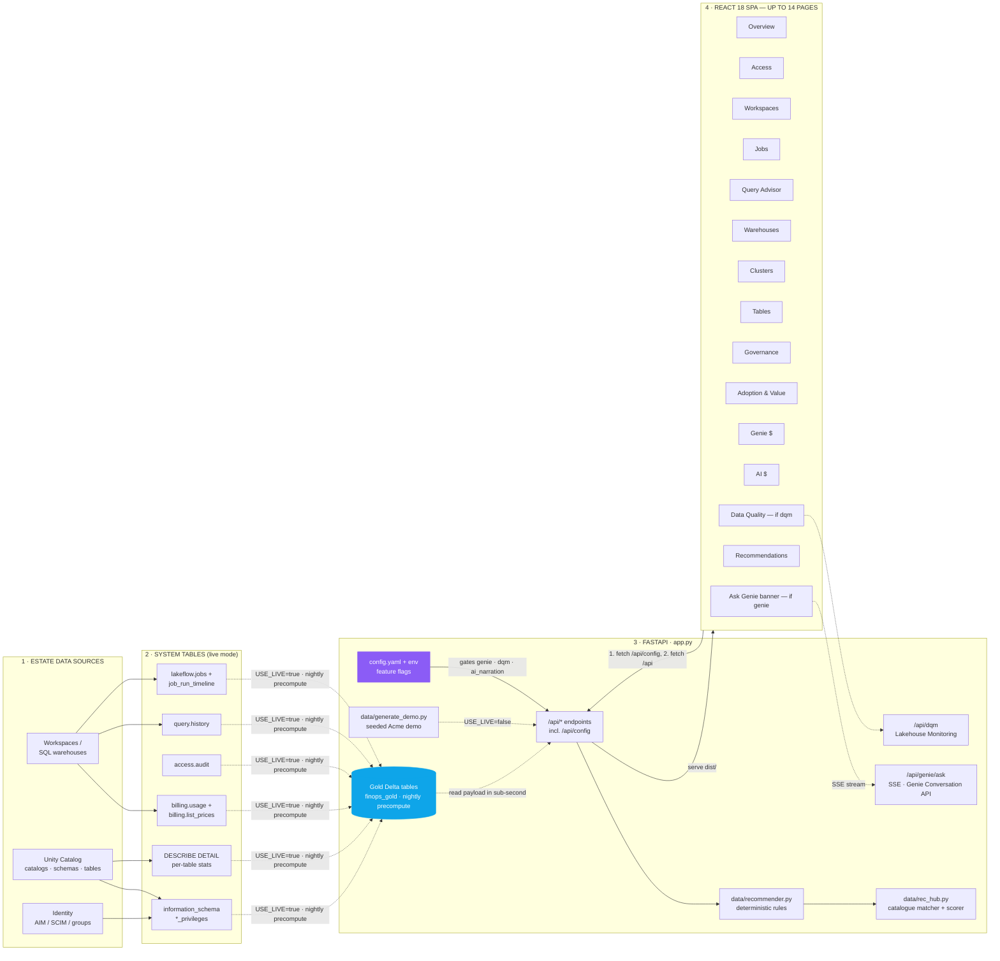
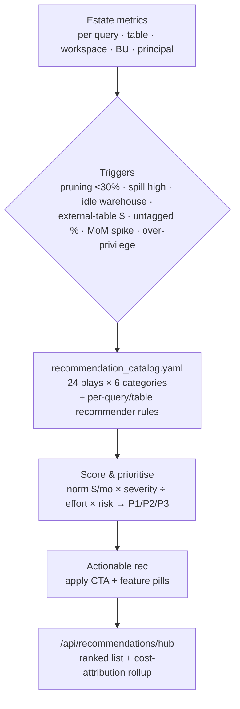
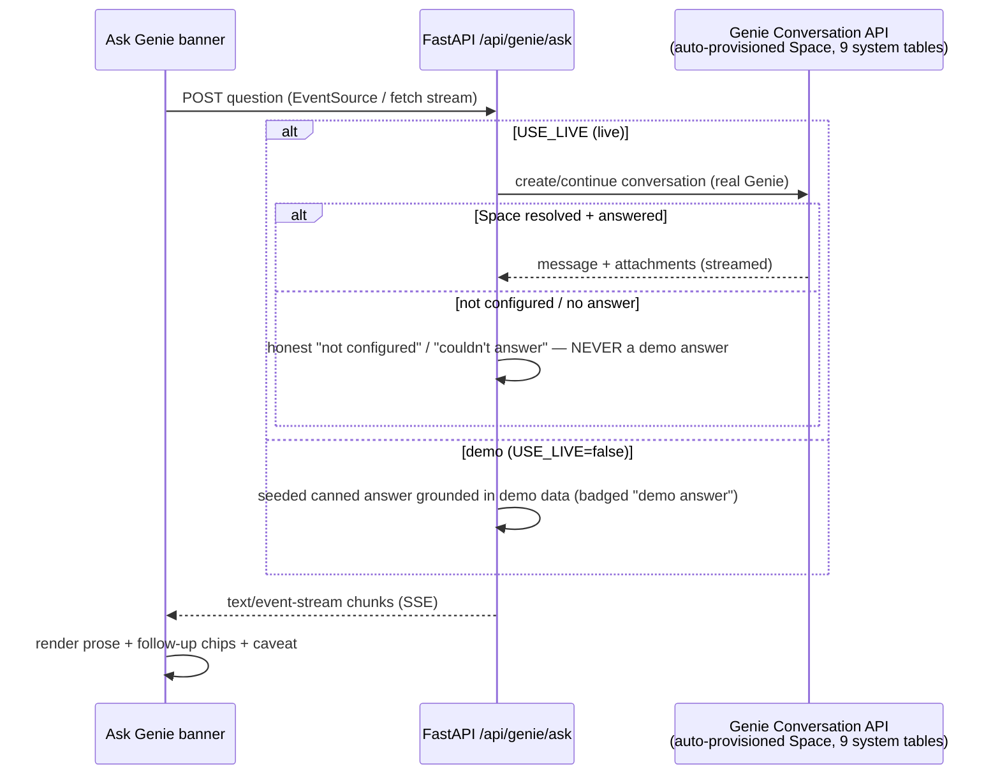
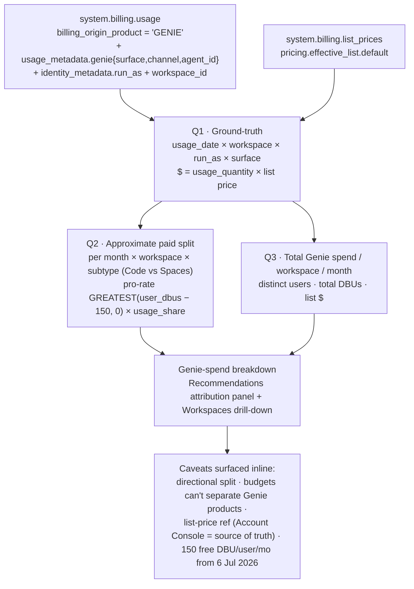

# Architecture — Estate Command Center

> Databricks-native cost, governance & data-quality console. A React 18 SPA over a FastAPI backend,
> deployed as a Databricks App via an Asset Bundle. Demo-first (`USE_LIVE=false`)
> with a live system-table path (`USE_LIVE=true`) documented and parameterised.
> Live mode serves from nightly precomputed **gold Delta tables** for
> sub-second reads.

---

## At a glance

**Read left to right:** estate data (1) lands in Databricks **system tables** (2); FastAPI (3) reads either the seeded demo dataset *or* those system tables, enriches every row through the deterministic **recommender** and the catalogue-driven **hub**, and (in live mode) serves each payload from the nightly precomputed **gold Delta tables** so reads return in sub-second time without a warehouse spin-up; the React SPA (4) is served by the same process and fetches `/api/*`. A **feature-flag config layer** (`config.yaml` + env) governs which surfaces exist: the SPA fetches `/api/config` *first*, then conditionally mounts the **Data Quality** tab (`dqm`), the **Ask Genie** banner (`genie`), LLM rec narration (`ai_narration`), and the **acknowledge/ignore** controls (`writeback`) — each independently switchable off. Hidden features are **inert server-side** — the endpoint returns 404 and makes no Genie/model call when the flag is off.

---

## Recommendation-engine flow

How raw estate metrics become scored, prioritised recommendations:

---

## Design decisions, by layer

### 1 · Estate data sources

The app is a *read-only* FinOps lens over an existing Databricks estate — it does not ingest new data. The three source families map cleanly onto system tables: **workspaces / warehouses** (usage, query history, jobs), **Unity Catalog** (privileges + physical table stats), and **identity** (principals, groups). Nothing here is bespoke ingestion — that is the point: any Databricks account already emits this.

### 2 · System tables (live mode)

| Table / source | Why it is the source of truth |
|---|---|
| `system.billing.usage` × `system.billing.list_prices` | The only account-complete record of DBUs and list `$` per workspace × SKU × product — backs Overview + Workspaces spend and the cost-attribution rollup. |
| `system.query.history` | Statement-level metrics (bytes read/pruned, spill, p50/p95, run count) — the raw signal the Query Advisor recommender reasons over, and the per-warehouse aggregation behind the Warehouse Monitor. **PuPr** in AU → badged. |
| `system.compute.clusters` + `system.compute.node_timeline` | Interactive/all-purpose cluster config (node type, workers, autoscale, auto-termination — an SCD table, latest row taken per cluster) and per-minute CPU/memory — the source for the Cluster Efficiency tab's idle/oversize/auto-stop findings. |
| `system.access.audit` | Last-access timestamps for stale-grant detection on the Access page. **PuPr** → badged. |
| `system.information_schema.*_privileges` | Effective UC grant graph (catalog/schema/table/routine); inherited-vs-direct resolved in the app layer. Backbone of the bidirectional Access explorer. |
| `system.lakeflow.jobs` + run timelines | Automated-% (scheduled jobs vs interactive) → the Workspaces health rule; top jobs by `$`. `*.pipelines` is PuPr, so the whole schema is *not* treated as GA. |
| `DESCRIBE DETAIL <fqn>` | `numFiles`, `sizeInBytes`, clustering/partition columns — must be issued per table; there is no single system query for physical layout today. |

The **Access** principal directory, group membership, workspace assignments and PAT inventory come from the account **SCIM / Groups API** and **workspace-assignments API** (REST), *not* SQL — grant graphs live in `information_schema`, but *who the principals are* lives in the identity plane.

**Effective-privilege resolution** (documented, done in the app layer): `direct = inherited_from IS NULL`; a principal's effective set on a securable = the union of its direct grants, grants inherited from ancestor securables, and grants held by every (nested) group it belongs to.

### 3 · FastAPI backend (`app.py` + `data/*`)

- **One process, two modes.** A single `USE_LIVE` env var switches the data source. `false` (default) serves `data/generate_demo.py`; `true` runs the parameterised SQL in `data/queries.sql` via the Databricks SDK Statement Execution API (`data/live.py`). Every payload is wrapped with `demo` / `mode` metadata so the UI can label demo numbers unambiguously — this is a hard requirement (never present synthetic numbers as live).
- **Gold-tables serving layer (required for live mode).** In live mode, the nightly `finops_gold_sync` job (`data/gold.py`) precomputes every estate payload — plus a per-table size census — into `<gold_schema>.finops_gold` and `<gold_schema>.finops_gold_table_sizes`. The app reads those Delta tables in ~1s via a small serverless SQL warehouse (scale-to-zero), so a page load is a keyed lookup, not a multi-second scan of the account-wide system tables. Large payloads are gzip+base64 encoded in the `payload` column (sentinel `gzip64:`) so the INSERT stays under the Statement Execution API's 16 MB statement-text limit. Config: `gold_schema` (env `FINOPS_GOLD_SCHEMA`). **Required in live mode** — the app's reads are account-wide (tens of millions of rows; live-per-request isn't production-viable), so with `USE_LIVE=true` and no gold schema (or no warehouse) the app **falls back to demo mode with a "finish setup to go live" banner** rather than failing to boot (`/api/config.live_setup_note`). Ignored in demo. Read-only-eval escape hatch: `FINOPS_ALLOW_LIVE_NO_GOLD=true` (slow).
- **Deterministic-first recommender** (`data/recommender.py`). Rules produce `{insight_type, rationale, est_savings_usd_month, confidence, next_steps[]}` for each query/table. Explainable and reproducible with no model call. This is why the Overview teaser, the Query Advisor table, and the Recommendations hub always agree — they score off the same rules over the same demo set.
- **Catalogue-driven hub** (`data/rec_hub.py`). `/api/recommendations/hub` matches estate metrics against the 24-play `recommendation_catalog.yaml`, adds the query/table recs, scores every rec (`norm $/mo × severity ÷ effort × risk` → P1/P2/P3), and returns one filterable list plus a cost-attribution rollup.
- **Optional LLM narration (`ai_narration`).** On by default, independently switchable off. It rewrites the recommendation *rationale* prose via the configured FMAPI Claude endpoint; otherwise it falls back to rule-templated text. It rewrites *prose*, never the numbers — and is distinct from Ask Genie.
- **EXPLAIN-validated query rewrites** (`data/rewrite.py`, `POST /api/queries/rewrite`). A second, on-demand use of the same in-region `FINOPS_LLM_ENDPOINT`: for a `rewrite`-type Query Advisor insight the operator can ask for a concrete rewritten `SELECT`. The model proposes it; the app then runs `EXPLAIN` against the customer's own warehouse and **only surfaces a rewrite that binds to the real schema** — a hallucinated column fails EXPLAIN and is rejected, never shown as runnable. A read-only guard (single `SELECT`/`WITH`, comment-stripped, no statement stacking) runs before anything reaches the warehouse, and EXPLAIN never executes the query. Honest by contract: EXPLAIN proves the rewrite *runs and binds*, not that results are identical — the UI says so. In demo mode a deterministic illustrative rewrite is shown instead (projecting the query's own predicate columns; never inventing names). Unlike narration this proposes *runnable SQL*, not prose, and needs a warehouse (for EXPLAIN) in live mode.
- **Static-after-API route order.** The SPA fallback route is registered *after* all `/api/*` routes and explicitly 404s `api/*` misses, so client-side routing works without shadowing the API.

### 4 · React SPA (up to 14 pages)

- **Shared component kit** (`components/shared`, `components/kpi`): `DataTable` (sortable), `FilterBar`, `Pill`, `KpiCard`/`KpiRow`, `Sparkline`, `ProgressBar`, `SpendSavingsChart`, plus the cost-by-driver cost-driver / spike-detection charts. Every page is a KPI row → filter bar → main table/detail, so the pages feel like one product.
- **Advice lives in one place.** Only Overview (a ranked teaser that deep-links out) and Recommendations (the full hub) carry advice. Access is deliberately AI-free — a factual grants explorer. Query Advisor is observability that *feeds* the hub. Data Quality is a monitoring inventory with a cost tie-in, not an advisor. This keeps the mental model clean: one advisor surface, everything else is evidence.
- **Config-first render.** The SPA fetches `/api/config` on boot and reads `features.{genie,dqm,ai_narration}` + `fx_rate` into Zustand before mounting the nav. The **Data Quality** tab and the **Ask Genie** banner are conditionally mounted from those flags; the USD/AUD toggle restates every `$` via `fx_rate`.
- **State** via Zustand (`store/appStore.ts`); data fetching via a thin `api/client.ts` + `hooks/useApi.ts`; Ask Genie streams via a `useGenieStream`-style SSE hook. Dark by default, DM Sans, GitHub-dark surface with Databricks-red accent.

### 5 · Feature-flag config layer (`config.yaml` + env → `/api/config`)

One config source, one precedence rule: **environment variable > `config.yaml` > built-in default** — so a customer flips a flag at deploy time without editing code. Four feature flags (`genie`, `dqm`, `writeback` on by default; `ai_narration` built-in default off, turned on by this repo's `config.yaml`), each independently switchable off. `app.py` resolves the flags at startup and:

- **`/api/genie/ask` returns 404 (and makes no Genie call)** when `features.genie` is false, **`/api/dqm` returns 404** when `features.dqm` is false, and **`/api/acks` returns 404** when `features.writeback` is false — hidden features are genuinely inert server-side, never merely unrendered (no stray Genie/model calls when disabled);
- exposes the resolved flags and `fx_rate` on **`/api/config`** for the SPA to gate its own rendering.

Any combination of the flags is valid; setting `FINOPS_FEATURE_*` to `"false"` in `app.yaml` ships any subset off. The **deterministic recommender, cost-attribution, and Genie-cost attribution are always on** — they call no model, so they are not gated as "AI features". Full detail in [`CUSTOMER_DEPLOYMENT.md`](CUSTOMER_DEPLOYMENT.md).

### 6 · Ask Genie — SSE streaming flow (`features.genie`)

Demo vs live is gated on **`USE_LIVE`**, not on whether `genie_space_id` is set. In **live** the app calls the real Genie Conversation API against a Space that is **auto-provisioned + auto-discovered by title** (curated over 9 cost/usage/ops system tables — see the [README Ask Genie section](../README.md#ask-genie)), so no manual `genie_space_id` is needed; if a Space is unavailable or Genie can't answer, it says so honestly and **never** serves a canned answer. The seeded `demo answer` (with the list-price caveat) appears **only in demo mode**.

### 7 · Data Quality — Lakehouse Monitoring source (`features.dqm`)

`/api/dqm` reads **Lakehouse Monitoring** as its data source, not a bespoke table:

- **Monitor inventory** — monitor metadata / `information_schema` (in live mode) yields each monitored `catalog.schema.table`, its **type** (Snapshot / TimeSeries / Inference), profile + drift metric tables, refresh cadence + last-refresh **freshness**, drift/quality status (anomaly count, PSI/KS, null %, distinct), `#metrics`, and alert count/status. Demo mode ships 12 representative monitors.
- **Cost tie-in** — the `DATA_QUALITY_MONITORING` line of `system.billing.usage` is joined to the monitored tables/workspaces to show *which monitors drive spend*, and to flag stale/quiet monitors for pruning (`$/mo` reclaimable). This is what makes DQM a **FinOps** view rather than a data-health view.

### 8 · Genie cost attribution — query flow (always on)

The `usage_metadata.genie.surface` field is treated as an **open enum** — the app labels whatever values appear (`GENIE_CODE` → Genie Code, `GENIE_ONE` → Genie Spaces, `GENIE_AGENTS` → Genie Agents, unknowns prettified) rather than assuming a fixed set, and degrades to per-user/workspace totals when it's null. It's populated in billing but not yet in the published schema doc, so treat as may-change. The 150-free-DBU-per-identified-user-per-month allowance is shared across subtypes, so the paid split pro-rates each user's paid DBUs across surfaces *after* the shared free allowance. Budgets cannot be separated by Genie product — only by account / workspace / user / group.

---

## Serving layer — gold tables

Live mode serves from nightly precomputed **gold Delta tables** — the layer that turns a multi-second system-table scan into a sub-second read. The scheduled `finops_gold_sync` job (`data/gold.py`) precomputes every estate payload — plus a per-table size census (metadata-only: it iterates `information_schema.tables` → `DESCRIBE DETAIL`, no data scan) — into `<gold_schema>.finops_gold` and `<gold_schema>.finops_gold_table_sizes`. The app then serves each estate page as a keyed lookup against those tables via a small serverless SQL warehouse (scale-to-zero), with **no per-request system-table scan**.

- **Config:** `gold_schema` (env `FINOPS_GOLD_SCHEMA`), e.g. `main.finops_gold`. **Required in live mode** — with `USE_LIVE=true` and no gold schema (or no warehouse) the app **falls back to demo mode with a "finish setup to go live" banner** rather than failing to boot; ignored in demo. Read-only-eval escape hatch: `FINOPS_ALLOW_LIVE_NO_GOLD=true` (computes each read live; slow, not for prod). No extra Python deps (just `databricks-sdk`).
- **Grant:** the `finops_gold_sync` job's service principal needs read on the system tables the app reads, plus `CREATE`/`MODIFY` on `<gold_schema>`.

## Scheduled jobs (`finops_gold_sync` + `finops_admin_sync`)

The bundle ships **two scheduled jobs**, both **PAUSED**:

- **`finops_gold_sync`** (`data/gold.py`, nightly 01:30) — precomputes the estate payloads + per-table size census into `<gold_schema>.finops_gold` and `<gold_schema>.finops_gold_table_sizes` (see the serving layer above).
- **`finops_admin_sync`** (`data/admin_sync.py`, daily 02:00) — pulls the account/workspace admin-API data that is **not** in system tables — budgets, budget/cluster policies, tokens, SCIM groups, workspace assignments, DQM monitors — into a Delta `<ingest_schema>.finops_admin` table (config key `ingest_schema`). Its service principal needs **account admin + workspace admin**, heavier than the app's read-only access.

---

## Data mode

- **Demo (default):** `USE_LIVE=false`. `app.py` serves the seeded dataset from `data/generate_demo.py`. Every payload carries `demo=true`; the UI shows a **DEMO DATA** badge.
- **Live:** `USE_LIVE=true` + a SQL warehouse. `app.py` runs the parameterised queries in `data/queries.sql` via the Databricks SDK Statement Execution API (`data/live.py`) — including the three [Genie cost-attribution](#8--genie-cost-attribution--query-flow-always-on) queries and the [DQM](#7--data-quality--lakehouse-monitoring-source-featuresdqm) monitor reads — serving from the precomputed gold tables when `gold_schema` is set (see above). Live mode is fully wired: the executor lives in `data/live.py` and the SQL and required grants are documented (see the README *Data requirements*).

Orthogonal to the data mode, the **feature flags** ([§5](#5--feature-flag-config-layer-configyaml--env--apiconfig)) decide which *surfaces* exist in either mode. The DQM tab and Ask Genie banner appear in both demo and live mode when their flags are on — demo mode simply seeds their data (12 monitors; canned Genie answers) rather than reading live sources.
